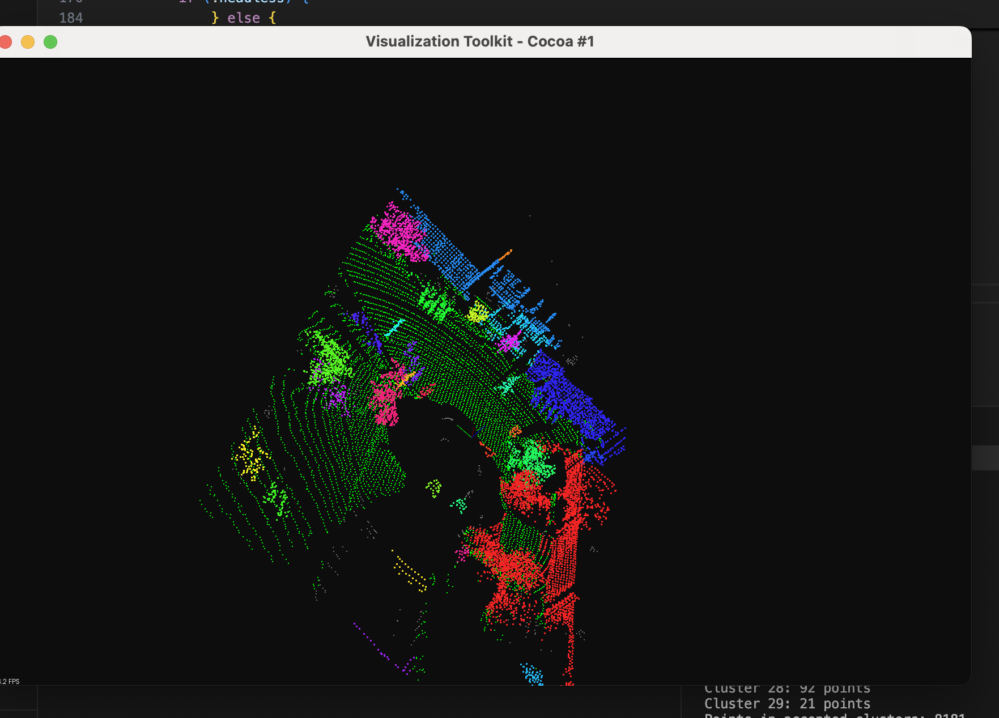

# LiDAR Obstacle Detection — C++17 / PCL

**Custom geometry-based 3D obstacle segmentation on KITTI Velodyne scans**, implemented in C++17 with the Point Cloud Library (PCL), and demonstrated on Apple Silicon (M2). Includes deterministic 3D RANSAC, a custom 3D KD-tree, iterative Euclidean clustering, 3D axis-aligned bounding boxes, interactive replay, and per-stage performance analysis.

> **What this project does:** identifies *spatial point-cloud clusters*; it does **not** assign semantic classes (car/pedestrian), track persistent object identities, operate on a live sensor, or prove sustained real-time performance. The KITTI object-detection training frames used here are not necessarily a time-continuous driving sequence.



**[Watch the 8.6-second replay demo (MP4)](docs/assets/sequence-playback.mp4)** · [Architecture](docs/ARCHITECTURE.md) · [Measured benchmarks](docs/BENCHMARKS.md) · [Reproduction guide](docs/REPRODUCIBILITY.md)

## Pipeline

```text
Sorted KITTI .bin file paths → FrameReader (XYZ + reflectance, pcl::PointXYZI)
  → finite-point filter → VoxelGrid (0.2 m) → 3D CropBox ROI
  → custom deterministic 3D RANSAC plane fitting
  → ground / non-ground partition
  → custom 3D KD-tree radius search + BFS Euclidean clustering
  → axis-aligned boxes per retained cluster
  → PCLVisualizer / headless statistics / optional CSV / PCL comparisons
```

**Implementation:** reusable `lidar_core` library; `apps/main.cpp` provides the `lidar_demo` CLI; 13 CTest executables cover loading, geometry, clustering, frame sequencing, pipeline timing and benchmarks. For module-level details see [architecture](docs/ARCHITECTURE.md).

## Results — 200 KITTI object-detection training frames

Measured in the supplied Milestone 11 Mac benchmark (one run):

| Metric | Result |
|---|---:|
| Median processing pipeline (excluding disk load/rendering) | **17.624 ms** |
| p95 processing pipeline | **34.963 ms** |
| Median disk load + pipeline | **49.579 ms** |
| p95 disk load + pipeline | **67.395 ms** |
| Observed headless wall throughput, **with optional PCL comparisons** | **13.420 FPS** |
| Custom/PCL cluster-count agreement | **200/200 frames** |
| Mean-best cluster Jaccard, median | **1.000** |

The normal processing pipeline and the optional reference benchmarks are timed separately. The measured headless wall throughput includes extra comparison work, CSV logging and console output, and should **not** be quoted as GUI FPS or live-LiDAR FPS. Agreement with PCL is not ground-truth semantic detection accuracy. See [methodology, full metrics and caveats](docs/BENCHMARKS.md).

## Requirements

- macOS on Apple Silicon (tested by project author on M2), C++17 with Apple Clang
- Homebrew PCL **1.15.1** (reported environment), CMake **3.20+**, Ninja
- KITTI **object detection** Velodyne binary frames downloaded separately
- Optional VS Code; GUI display for `PCLVisualizer`

Dependencies are **not** bundled. Install only if missing; see [reproducibility](docs/REPRODUCIBILITY.md) for environment recording and a fresh-machine procedure.

## Build and test

```bash
# From repository root; requires PCL installed and discoverable
cmake -S . -B build -G Ninja -DCMAKE_BUILD_TYPE=Release \
  -DCMAKE_PREFIX_PATH="$(brew --prefix pcl);$(brew --prefix)"
cmake --build build -j 4
ctest --test-dir build --output-on-failure
./build/lidar_demo --help
```

The prior run on the author's Mac reported **13/13 passing**. Tests have **not** been rebuilt in this documentation package's environment. See [validation checklist](VALIDATION_CHECKLIST.md).

## Run

The input may be a single valid KITTI `.bin` file or a folder of such files. Quote paths containing spaces.

```bash
# Interactive multi-frame replay, with target GUI cadence (NOT measured throughput)
./build/lidar_demo "/path/to/kitti/training/velodyne" --fps 10 --max-frames 100

# Start paused; F to advance
./build/lidar_demo "/path/to/kitti/training/velodyne" --step --max-frames 100

# Headless analysis; outputs must be NEW paths (no silent overwrite)
./build/lidar_demo "/path/to/kitti/training/velodyne" \
  --headless --max-frames 200 --compare-pcl \
  --csv run_$(date +%Y%m%d_%H%M%S).csv \
  --report run_$(date +%Y%m%d_%H%M%S).md
```

`--compare-pcl` requires `--headless`. For reproducible output filenames, see the single-timestamp commands in [REPRODUCIBILITY.md](docs/REPRODUCIBILITY.md). The program's `--help` is the authoritative options list.

| CLI flag | Function |
|---|---|
| `--headless` | Process without PCL viewer |
| `--fps N` | Target GUI replay cadence; default 10 |
| `--step` | Start GUI paused |
| `--max-frames N` | Limit frame count |
| `--csv PATH` | Write a new metrics CSV |
| `--compare-pcl` | Headless-only reference benchmark |
| `--report PATH` | Write a new Markdown report |
| `--help` | Display usage |

**Viewer keys:** `Space` pause/resume; `F` forward; `B` backward (when paused); `Q` quit; `G` toggle ground; `N`/`P` select next/previous cluster; `A` show all; `0`–`9` select cluster. Some keys act only during sequence replay or when clusters exist.

## Data and defaults

- KITTI frame encoding: repeating **4 × 32-bit floats** `(x, y, z, reflectance)` → `pcl::PointXYZI`.
- Voxel leaf: **0.2 m**; crop ROI: X `[-15, 35]`, Y `[-10, 10]`, Z `[-3, 4]` metres.
- RANSAC: **100** iterations; **0.2 m** plane tolerance; random seed **42**; max tilt **25°**.
- Clustering: radius **0.5 m**; retain **20–10,000** points per cluster.
- Consecutive filenames in the **KITTI object-detection training** directory should **not** be interpreted as a recorded temporal driving trajectory.

See [dataset instructions](docs/DATASET.md) and [known limitations](docs/LIMITATIONS.md).

## Repository layout

```text
apps/main.cpp                CLI and playback
include/lidar/              C++ public headers
src/                        implementations
config/                     reserved configuration directory

tests/                      13 CTest test sources
docs/ARCHITECTURE.md         system diagram and execution paths
docs/BENCHMARKS.md           real 200-frame experiment
docs/benchmarks/             supplied CSV and generated Markdown report
docs/DATASET.md              acquisition/format/provenance
docs/REPRODUCIBILITY.md      macOS build and rerun procedure
docs/LIMITATIONS.md          boundaries and future work
docs/assets/                 screenshot and demo recording
VALIDATION_CHECKLIST.md     one final local acceptance checklist
```

## Notes and scope

Processing is geometric, not learned. PCL reference algorithms are used only for opt-in comparison; core RANSAC, KD-tree neighbor queries, clustering, and AABBs are custom C++ implementations. The archived experiment is provided for transparency, not to claim superiority: PCL is faster in both measured reference comparisons. No project license has been selected here: **do not assume permission to redistribute code or KITTI assets**. Add a license only after deciding how to release your work.
