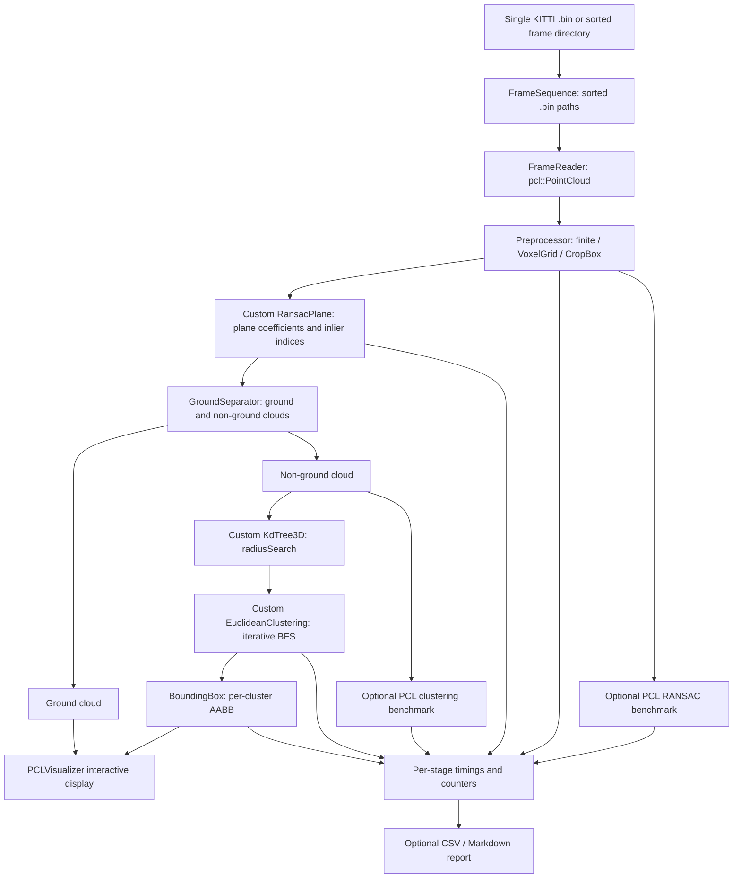

# Architecture and data flow

## Components and types

The application is a **frame replay** processor. `FrameSequence` discovers `.bin` inputs and excludes macOS `._` AppleDouble sidecar files. `FrameReader` parses x/y/z/reflectance float tuples into `pcl::PointXYZI`. The preprocessor filters invalid points, downsamples with PCL `VoxelGrid`, and crops by PCL `CropBox`. The custom RANSAC plane model marks ground inliers; the separator partitions the point cloud. A custom 3D KD-tree supplies neighbor searches for iterative region-growing clusters. Valid clusters yield minimum/maximum XYZ axis-aligned bounding boxes. The viewer shows the resulting geometric groups; it does not output labels or tracks.

## Execution paths

**Interactive path:** application parses options → enumerates and sorts frames → processes each frame via `Pipeline` → viewer updates cloud/cluster/box actors, retains camera/controls. `--fps` controls target presentation cadence, not processing throughput. `--step` starts paused.

**Headless path:** frames are read and passed through the same perception pipeline, without rendering. Optional `--csv` records per-frame timings; `--report` aggregates descriptive metrics; `--compare-pcl` conducts *separate* PCL algorithm reference runs on comparable point-cloud inputs. That flag cannot be combined with GUI mode.

## Source ownership

| Stage | Key source files |
|---|---|
| I/O and discovery | `frame_reader.*`, `frame_sequence.*` |
| Preprocessing | `preprocessing.*` |
| Plane estimation and split | `ransac_plane.*`, `ground_separator.*` |
| Neighbors, clusters and boxes | `kdtree3d.*`, `euclidean_clustering.*`, `bounding_box.*` |
| Orchestration | `pipeline.*` |
| Display | `visualization.*` |
| Profiling and reference | `metrics_logger.h`, `performance_report.*`, `pcl_comparison.*` |
| CLI entry point | `apps/main.cpp` |

The original implementation and its tests are unchanged in this documentation release. For precise contracts, read the corresponding headers in `include/lidar/`.
